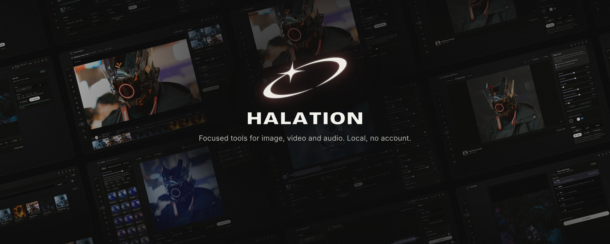
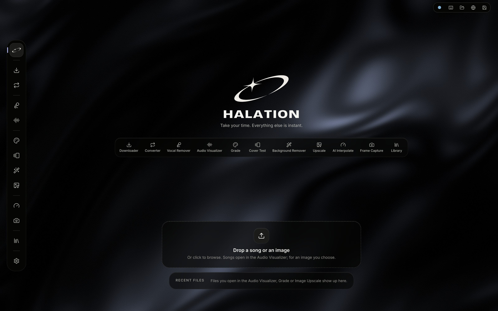
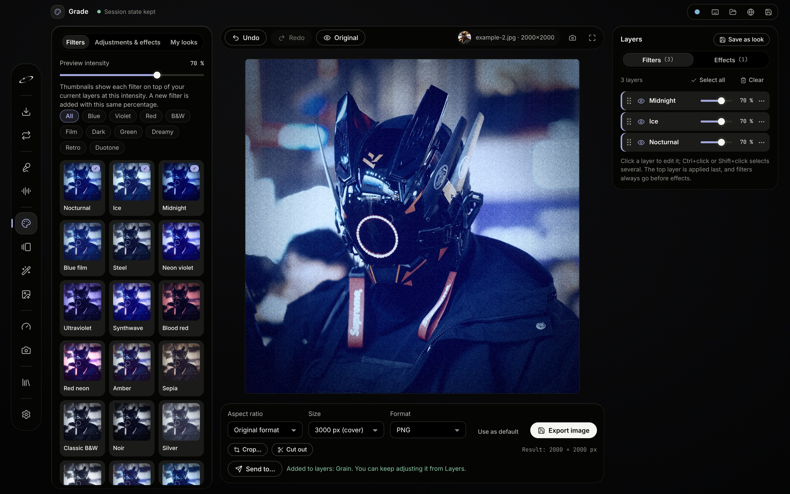
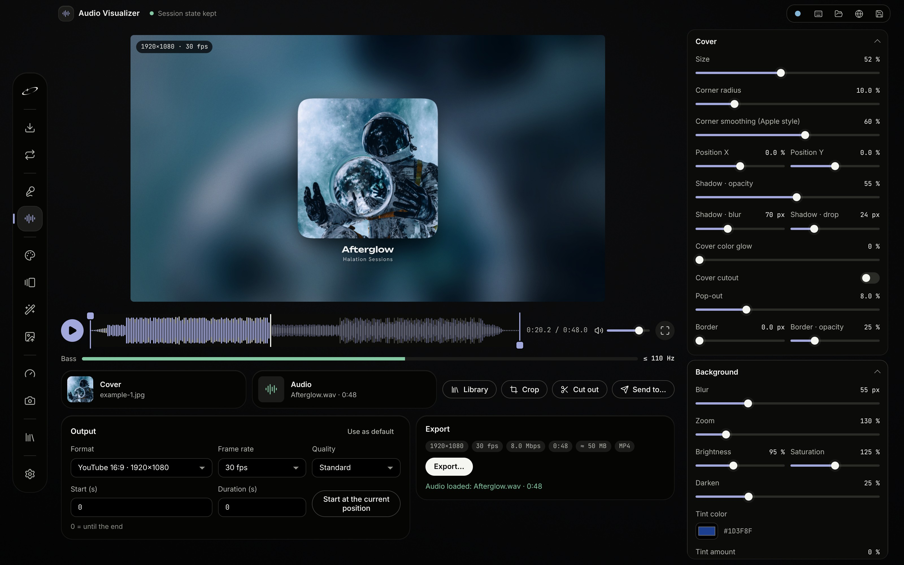

  <a href="https://github.com/Sylphera/Halation/releases/latest">Download</a>
  ·
  <a href="CHANGELOG.md">Changelog</a>
  ·
  <a href="PRIVACY.md">Privacy</a>
  ·
  <a href="LICENSE">License</a>

### A local creative workspace for image, video and audio.

Focused tools for the media work between the big apps — no account, no watermark, with media processing kept local by default.

  <table>
    <tr>
      <td colspan="2">
        
      </td>
    </tr>
    <tr>
      <td width="50%">
        
      </td>
      <td width="50%">
        
      </td>
    </tr>
  </table>
  One workspace. Focused tools that can stay independent or hand results off to each other.

> [!NOTE]
> **Halation is proprietary, closed-source freeware.** This repository distributes official builds, documentation and public project assets. The application source code is not published here.

## Features

- Download video, audio or artwork from supported links, and convert media, documents and PDF pages.
- Separate music into vocals/instrumental or four stems, on GPU or CPU.
- Grade images, test cover artwork in platform-style layouts and remove backgrounds with manual refinement.
- Upscale images and video, interpolate video frame rates and capture exact full-resolution frames.
- Turn audio and artwork into audio-reactive videos for widescreen, square and vertical formats.
- Keep exports, favourites, tags and linked folders together in Library.
- Move compatible results between tools with **Send to…**, with shared **Cutout** and **Crop** editing where useful.

Halation is not one giant editor. Each tool is designed to be useful on its own, while the workspace keeps files, jobs, exports, presets and recent work together.

## Installation

Halation supports **Windows 10 and 11** and requires WebView2.

Download the latest stable release from **[Releases](https://github.com/Sylphera/Halation/releases/latest)**.

- `Halation_<version>_x64-setup.exe` installs for the current user without administrator rights.
- `Halation_<version>_x64-portable.exe` runs without installation.

> [!NOTE]
> Current builds are not Authenticode-signed, so Windows SmartScreen may warn on first launch. If the file came from this repository, choose **More info → Run anyway**.

Heavy processing components are installed only when a feature needs them. This keeps the base app smaller and avoids downloading every engine and model up front. Components are managed from **Settings → Modules** and stored under `Documents\Halation\Tools`.

## How the workspace fits together

Home is the common entry point for tools, recent files and drag-and-drop media. **Send to…** passes results between compatible workflows without forcing everything into a single editing model.

Presets, looks, projects, exports and settings remain regular local files under `Documents\Halation`, and Library provides a common place for exports, downloads, favourites, tags and linked folders.

## Local-first

Halation does not require an account or a Halation-hosted cloud service. Media processing is local by default.

Some features intentionally use the network when invoked: Downloader and URL analysis contact relevant services, update checks read release metadata, and optional engines or models are downloaded from their upstream hosts.

See **[PRIVACY.md](PRIVACY.md)** for the full network and data-handling boundary.

## Development

Halation is developed with extensive use of AI coding agents as engineering tools for implementation, refactoring, debugging, profiling, testing, research and documentation.

Product direction, interface decisions, visual acceptance, quality thresholds and release decisions remain human-led. Agent-produced changes are reviewed and tested, with benchmarking where performance is part of the requirement.

## License

Halation is **proprietary freeware, not open-source software**. Personal and commercial use is permitted under the **[Halation Freeware License](LICENSE)**, and Halation does not claim ownership of user outputs.

Third-party tools, libraries, models and model weights retain their own licenses and terms. See **[THIRD_PARTY.md](THIRD_PARTY.md)** for notices and credits.

Use Downloader only for content you own or have permission to download.

---

  <b>Make the useful part fast.</b> 
  Halation · Freeware for Windows

