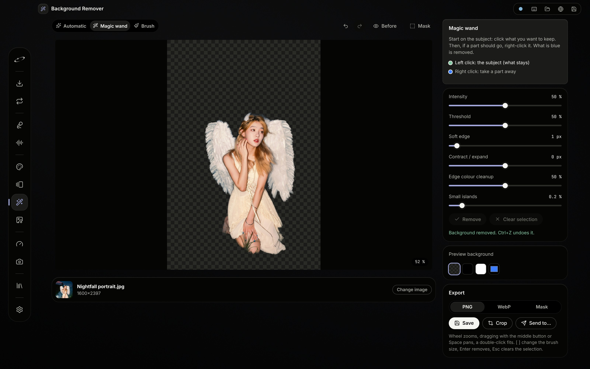
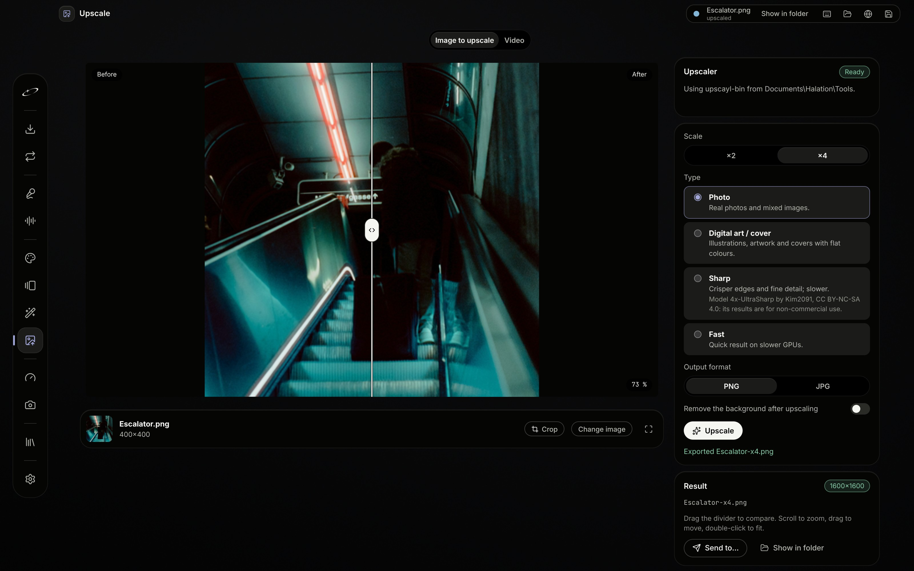
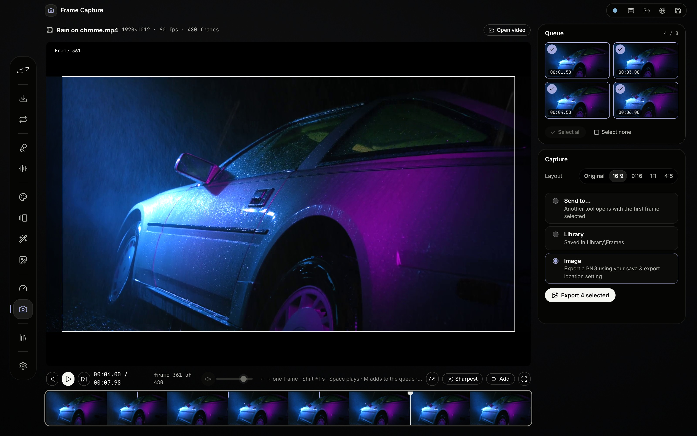
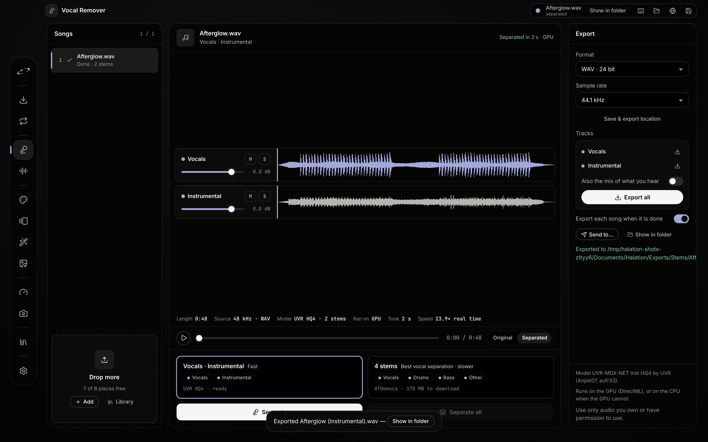
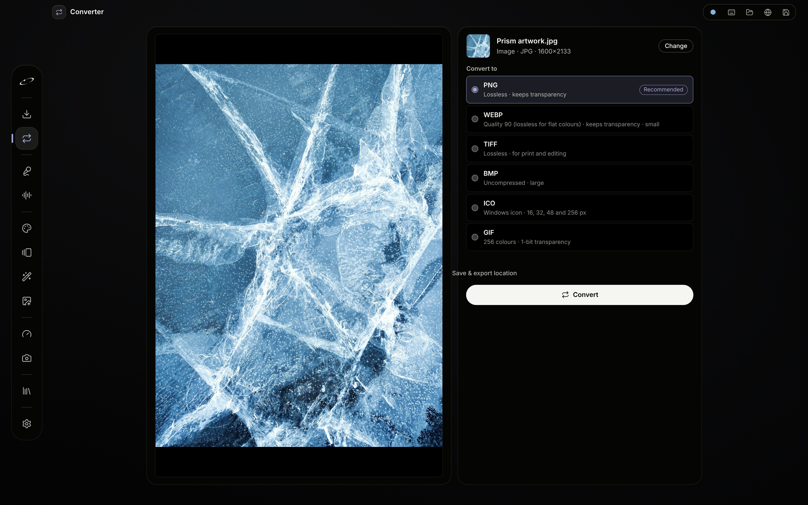
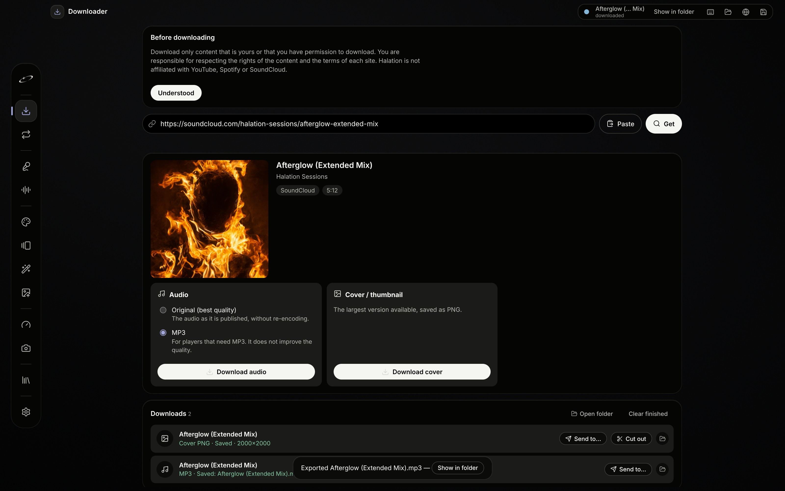
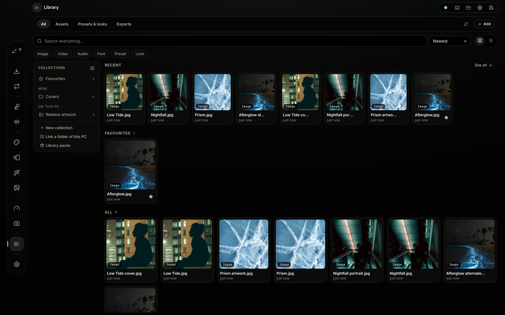

### A local creative workspace for image, video and audio.

Grade, upscale, isolate, interpolate, extract, separate, convert and organize media — in one Windows app.

  
  
  

**No account. No mandatory cloud processing. No Halation analytics.**

  

Halation brings the small creative jobs that usually spill into separate apps into one consistent workspace. Open media, work with it, keep related files close, and export without rebuilding the workflow every time.

## Built for the work between the big apps

Halation is not trying to replace a full editor or DAW. It focuses on the jobs around them: preparing media, cleaning it up, extracting what is useful, converting it, testing presentation, and moving quickly between formats.

- **Image finishing** — grade images, upscale media, remove backgrounds and refine cutouts.
- **Video utilities** — grab frames, interpolate motion and prepare media for other workflows.
- **Audio tools** — separate vocals/instrumentals or four stems, then audition and export them.
- **Conversion** — convert images, audio, video, documents, spreadsheets, presentations and PDF pages into useful target formats.
- **Collection & reuse** — keep working files in Library, save Sessions and recover interrupted work.
- **Creative context** — use Cover Test, profiles and visual references without turning the workspace into a browser full of tabs.

## Explore Halation

<table>
<tr>
<td width="50%" valign="top">

### Grade

Finish still images inside a focused grading workspace.

</td>
<td width="50%" valign="top">

### Background Remover

Automatic subject selection plus promptable refinement for cleaner masks and cutouts.

</td>
</tr>
<tr>
<td width="50%" valign="top">

### Upscale

Prepare low-resolution images and video for larger outputs with local models.

</td>
<td width="50%" valign="top">

### Frame Grab

Move through video and pull out the frames worth keeping.

</td>
</tr>
<tr>
<td width="50%" valign="top">

### Vocal Remover

Separate vocals and instrumental, or split a track into vocals, drums, bass and other stems with per-song mixing and export.

</td>
<td width="50%" valign="top">

### Converter

Convert one file or a whole folder, preview the result, and choose settings per format group in batches.

</td>
</tr>
<tr>
<td width="50%" valign="top">

### Downloader

Bring supported online media into the same workspace when the content is yours or you have permission to download it.

</td>
<td width="50%" valign="top">

### Library

Keep media close to the tools that use it, including files stored outside Halation's own workspace.

</td>
</tr>
</table>

Halation also includes **Interpolation**, **Visualizer**, **Cover Test** and related utilities, with a shared interface and export behavior across the workspace.

## Local by design

The images, video and audio opened in Halation are processed locally on the PC. The app does not require an account, login or cloud-processing service for its editing, AI enhancement and export tools, and Halation does not include its own analytics or advertising telemetry.

Some features intentionally use the network when invoked. Downloader and URL analysis contact the relevant services; profile discovery and Cover Test can query public services; update checks read Halation's public GitHub release metadata; and optional engines or models may be downloaded from their upstream hosts.

Read the complete policy in **[PRIVACY.md](PRIVACY.md)**.

## Sessions that survive interruption

Halation supports manual Sessions with **Save**, **Save As** and **Open Session**. Saved Sessions can be written automatically while changes are pending, and crash recovery can restore interrupted work on the next launch.

The interface is available in **English and Spanish**.

## Download

Prebuilt Windows x64 releases are published on GitHub in two forms:

| Edition | Best for | Update behavior |
| --- | --- | --- |
| **Setup** | Normal installation | Supports Halation's in-app update flow through official GitHub releases |
| **Portable** | Running without installation | Opens the release page when an update is available |

**[Download the latest release →](https://github.com/Sylphera/Halation/releases/latest)**

Official Halation installers and portable builds are distributed through authorized channels only. Sharing a link to the official download is fine; repackaging or redistributing Halation itself is not permitted by the license.

## Freeware, not open source

Halation is **proprietary freeware**. It can be downloaded and used free of charge for personal and commercial work under the [Halation Freeware License](LICENSE).

Files and work created or processed with Halation remain yours to the extent you already hold those rights, and Halation charges no royalties for outputs made with its own features.

> [!IMPORTANT]
> Some optional third-party models, tools and datasets have their own licenses or usage restrictions. Those terms can apply independently to the results they produce. Check **[THIRD_PARTY.md](THIRD_PARTY.md)** before using third-party-model outputs commercially.

## Repository

This repository is the official home for Halation releases, product documentation, screenshots, privacy information and licensing notices.

- **[Latest release](https://github.com/Sylphera/Halation/releases/latest)**
- **[Changelog](CHANGELOG.md)**
- **[Privacy](PRIVACY.md)**
- **[Halation license](LICENSE)**
- **[Third-party notices](THIRD_PARTY.md)**
- **[Report an issue](https://github.com/Sylphera/Halation/issues)**

---

**Halation** — image, video and audio tools in one local workspace.

