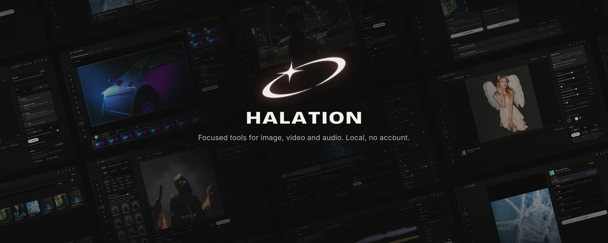
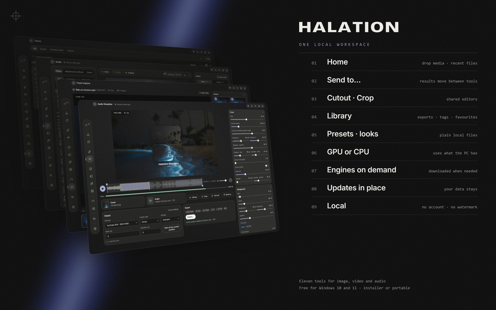
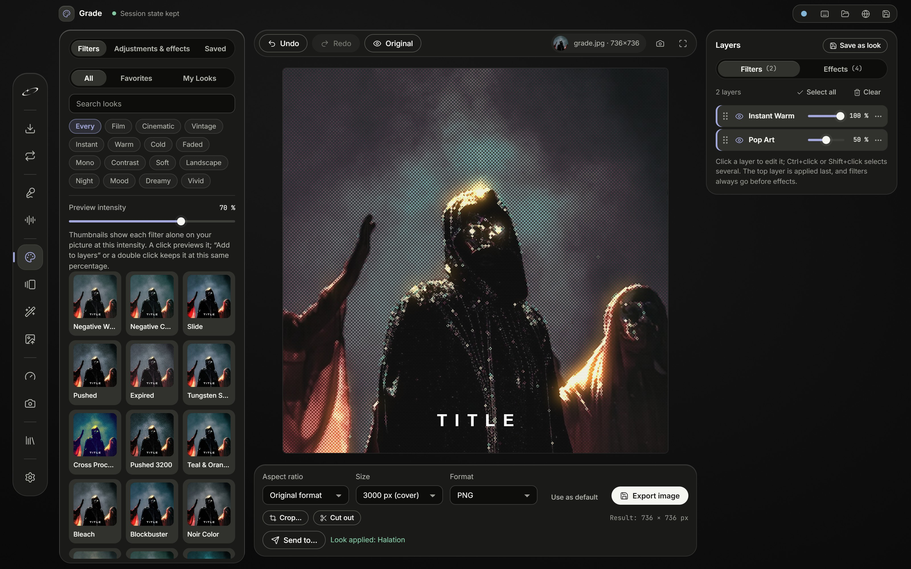
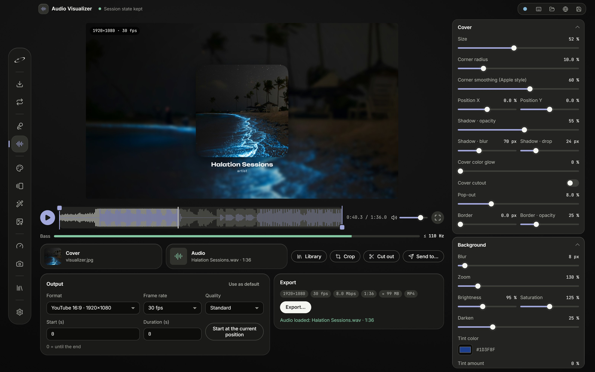
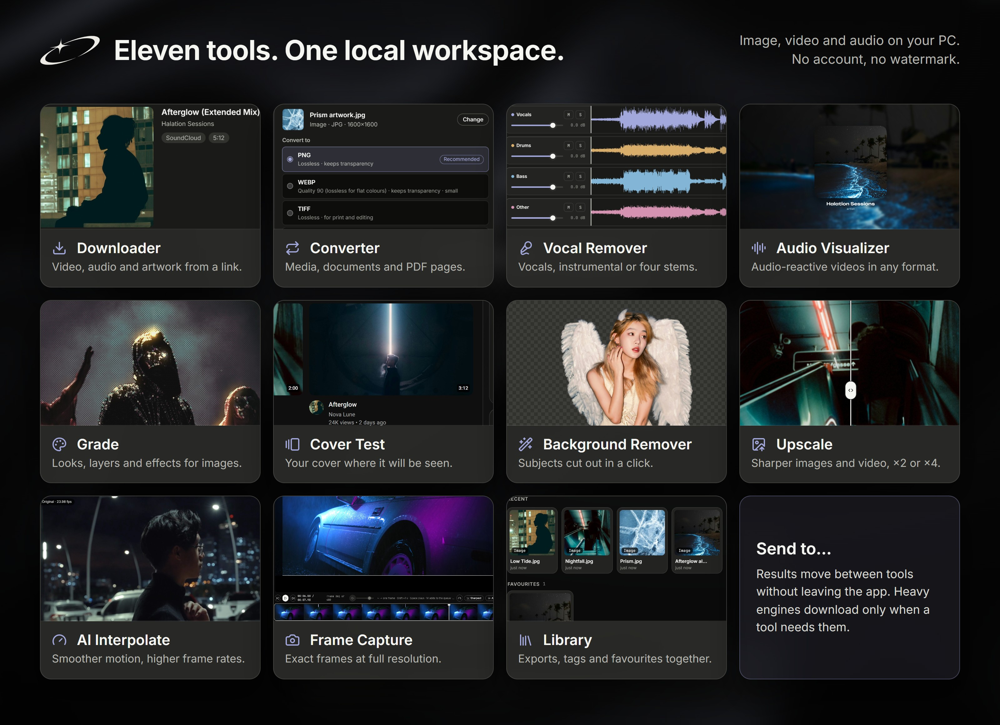

<div align="center">



### A local creative workspace for image, video and audio.

Focused tools for the media work between the big apps — no account, no watermark, with media processing kept local by default.

<p>
  <a href="https://github.com/Sylphera/Halation/releases/latest"></a>
</p>
<p>
  <a href="CHANGELOG.md"></a>
  <a href="PRIVACY.md"></a>
  <a href="LICENSE"></a>
</p>

<p>
  <a href="https://github.com/Sylphera/Halation/releases/latest"></a>
  <a href="https://github.com/Sylphera/Halation/releases"></a>
  <a href="LICENSE"></a>
  
  
  
</p>

</div>

<div align="center">
  <table>
    <tr>
      <td colspan="2">
        
      </td>
    </tr>
    <tr>
      <td width="50%">
        
      </td>
      <td width="50%">
        
      </td>
    </tr>
  </table>
  <sub>One workspace. Focused tools that can stay independent or hand results off to each other.</sub>
</div>

> [!NOTE]
> **Halation is open source.** The code, the official builds, the issues and the documentation live in this repository, under the GNU GPL v3.

## Features

<div align="center">
  
</div>

- Download video, audio or artwork from supported links, and convert media, documents and PDF pages.
- Separate music into vocals/instrumental or four stems, on GPU or CPU.
- Grade images, test cover artwork in platform-style layouts and remove backgrounds with manual refinement.
- Upscale images and video, interpolate video frame rates and capture exact full-resolution frames.
- Turn audio and artwork into audio-reactive videos for widescreen, square and vertical formats.
- Keep exports, favourites, tags and linked folders together in Library.
- Move compatible results between tools with **Send to…**, with shared **Cutout** and **Crop** editing where useful.

Halation is not one giant editor. Each tool is designed to be useful on its own, while the workspace keeps files, jobs, exports, presets and recent work together.

## Installation

Halation supports **Windows 10 and 11** and requires WebView2.

Download the latest stable release from **[Releases](https://github.com/Sylphera/Halation/releases/latest)**.

`Halation_x64-setup.exe` installs for the current user without administrator rights.

> [!NOTE]
> Current builds are not Authenticode-signed, so Windows SmartScreen may warn on first launch. If the file came from this repository, choose **More info → Run anyway**.

Heavy processing components are installed only when a feature needs them. This keeps the base app smaller and avoids downloading every engine and model up front. Components are managed from **Settings → Modules** and stored under `Documents\Halation\Tools`.

## How the workspace fits together

Home is the common entry point for tools, recent files and drag-and-drop media. **Send to…** passes results between compatible workflows without forcing everything into a single editing model.

Presets, looks, projects, exports and settings remain regular local files under `Documents\Halation`, and Library provides a common place for exports, downloads, favourites, tags and linked folders.

## Local-first

Halation does not require an account or a Halation-hosted cloud service. Media processing is local by default.

Some features intentionally use the network when invoked: Downloader and URL analysis contact relevant services, update checks read release metadata, and optional engines or models are downloaded from their upstream hosts.

See **[PRIVACY.md](PRIVACY.md)** for the full network and data-handling boundary.

## This branch: the native rebuild

This branch (`slint/native`) holds **Halation Slint**, the native rebuild in Rust, [Slint](https://slint.dev) and
Skia. It is not released yet: the published app above is **Halation Tauri**, on
[`main`](https://github.com/Sylphera/Halation/tree/main), which keeps its own build instructions. The native app has
its own profile and does not read Tauri user data.

```powershell
git clone -b slint/native https://github.com/Sylphera/Halation.git
cd Halation
cargo run -p halation-app      # run from source (Windows 10/11, Rust with MSVC)
cargo test --workspace         # tests
```

### Repository map

| Path | What |
| --- | --- |
| `crates/halation-core/` | Logic without UI: jobs, processes, Library, sections, presets, storage |
| `crates/halation-app/` | The app: lifecycle, Slint interface (`ui/`), navigation, controllers |
| `assets/` | Files installed beside the executable: icons, fonts, brand, the Drape loop |
| `tools/` | Developer scripts: launching and measuring the beta, recording the Drape, checking the docs |
| `docs/` | How Halation works; start at [docs/README.md](docs/README.md) |
| `planning/` | Status, roadmap, decisions and active plans |
| `research/` | Measurements and experiments |
| `archive/` | Documents that no longer apply (the Tauri app, superseded plans) |

[CONTRIBUTING.md](CONTRIBUTING.md) explains how to propose changes; [AGENTS.md](AGENTS.md) holds the rules every
contributor follows, people and AI agents alike.

## Development

Halation is developed with extensive use of AI coding agents as engineering tools for implementation, refactoring, debugging, profiling, testing, research and documentation.

Product direction, interface decisions, visual acceptance, quality thresholds and release decisions remain human-led. Agent-produced changes are reviewed and tested, with benchmarking where performance is part of the requirement.

## License

Halation is **free software** under the **[GNU General Public License v3.0 or later](LICENSE)**: you can use it for any purpose, study and change the code, and share it and your changes under the same license. See **[NOTICE.md](NOTICE.md)** for the details, including the permission for the bundled GSAP library. Halation does not claim ownership of your outputs.

The name "Halation", its logo and its icon are not covered by the GPL: a fork needs its own name and icon. See **[TRADEMARKS.md](TRADEMARKS.md)**.

Third-party tools, libraries, models and model weights retain their own licenses and terms. See **[THIRD_PARTY.md](THIRD_PARTY.md)** for notices and credits.

Use Downloader only for content you own or have permission to download.

---

<div align="center">
  <b>Make the useful part fast.</b><br>
  <sub>Halation · Free and open source for Windows</sub>
</div>
